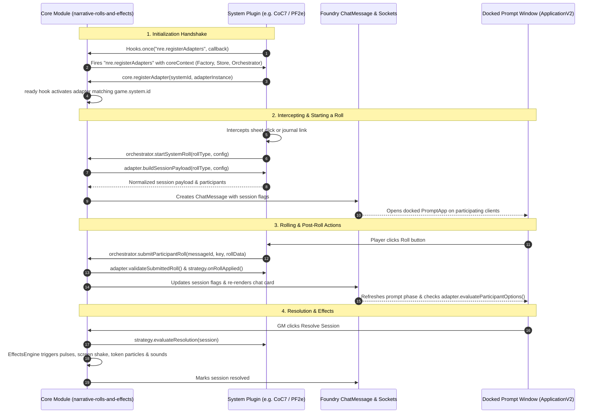

# Narrative Rolls and Effects

An extensible Foundry VTT v14 module that provides synchronized, multi-phase roll prompts, interactive chat cards, visual effects, and audio cues.

## Features

- Docked `ApplicationV2` roll prompts with synchronized session state.
- System adapters registered through the `nre.registerAdapters` hook.
- Core dice visualization and dice-face assets, with adapter-provided extensions for system-specific dice.
- Declarative prompt class creation and extension through `PromptClassFactory`.
- GM roll requests, modifier preparation, actor selection, and configurable result presentation.
- Client-side vignettes, result pulses, screen shake, token particles, and audio cues.
- System-scoped prompt and chat-card styling through `data-nre-system`.

## Plugin architecture

The core module has no direct dependency on any game system. Companion modules register an adapter during `nre.registerAdapters`, using the provided `registerAdapter` function. The hook also exposes prompt-class factories and core services for sessions, roll orchestration, visibility, effects, actor selection, and dice visualization.

Adapters can extend the core dice visuals by implementing `extendDiceVisuals(dice, session, modifierDice)`.
The core also manages the modifier-preparation prompt shell; adapters select system- and roll-specific header and detail partials with `getModifierPreparationPartials(session)`.
Adapters can also provide system-specific chat-card templates, roll-request composer tabs and forms, session phases, prompt context, and roll actions.

System rules, prompt templates, chat cards, and system-specific dice assets belong in companion modules. The core supplies the shared session lifecycle, prompt infrastructure, neutral dice visuals, and effects engine.

## Plugin Architecture & Communication

**Narrative Rolls and Effects** acts as a system-agnostic core platform. System-specific integrations (such as `narrative-rolls-and-effects-coc7` or `narrative-rolls-and-effects-pf2e`) are implemented as standalone companion modules that communicate with the core without direct cross-module file imports.

### Lifecycle & Sequence Diagram



---

## Creating a New System Adapter

To add support for another game system (for example `pf2e`), create a standalone Foundry VTT module that depends on `narrative-rolls-and-effects`.

### 1. Module Manifest (`module.json`)

Declare both the target game system and the core module under `relationships`:

```json
{
  "id": "narrative-rolls-and-effects-pf2e",
  "title": "Narrative Rolls and Effects - Pathfinder 2e",
  "description": "Pathfinder 2nd Edition integration for Narrative Rolls and Effects.",
  "version": "1.0.0",
  "compatibility": {
    "minimum": "14",
    "verified": "14"
  },
  "relationships": {
    "systems": [
      { "id": "pf2e", "type": "system", "compatibility": {} }
    ],
    "requires": [
      { "id": "narrative-rolls-and-effects", "type": "module", "compatibility": {} }
    ]
  },
  "esmodules": ["module/main.mjs"],
  "styles": ["styles/pf2e.css"],
  "languages": [
    { "lang": "en", "name": "English", "path": "lang/en.json" }
  ]
}
```

### 2. Connecting via `core-bridge.mjs`

Do **not** import files directly from `modules/narrative-rolls-and-effects/`. Instead, capture the `core` context passed to `nre.registerAdapters` inside a local bridge module:

```javascript
let coreApi;

export function setCoreApi(api) {
  coreApi = api;
}

export function getCore() {
  if (!coreApi) throw new Error("Narrative Rolls core API is not initialized.");
  return coreApi;
}
```

Register your adapter in `module/main.mjs`:

```javascript
import { setCoreApi } from "./core-bridge.mjs";
import { Pf2eAdapter } from "./pf2e/pf2e-adapter.mjs";

Hooks.once("nre.registerAdapters", (core) => {
  setCoreApi(core);
  core.registerAdapter("pf2e", new Pf2eAdapter());
});
```

### 3. Implementing the System Adapter Interface

Your adapter class must implement the core lifecycle and formatting hooks expected by the engine:

| Method | Purpose |
| :--- | :--- |
| `initialize()` | Registers sheet/system roll interceptors, custom particle presets, and dynamic prompt classes via `core.createPromptClass(...)`. |
| `getStrategy(rollType)` | Returns the strategy object responsible for `renderPrompt(options)`, `onRollApplied(participant, state)`, `applyConsequences(state)`, and `evaluateResolution(state)`. |
| `buildSessionPayload(type, cfg)` | Converts system-specific roll options into a standardized session config with `participants` created via `core.session.buildParticipant(...)`. |
| `getInitialSessionFields(cfg)` | Returns default system-specific properties stored on the session flag object. |
| `enrichSessionForTemplate(session)` | Computes derived display properties for Handlebars templates. |
| `validateSubmittedRoll(session, participant, rollData)` | Validates incoming roll totals and modifiers on the GM client. |
| `evaluateParticipantOptions(participant, session, isDelegated)` | Determines available post-roll actions (e.g., spending a Hero Point in PF2e or Luck in CoC7). |
| `handlePostRollAction(session, key, actionId, payload)` | Executes post-roll actions and returns `{ session, finalize: boolean }`. |
| `formatRollOutcome(params)` | Formats numeric results and degrees of success for prompts and chat cards. |
| `getRollEffectType(participant)` | Returns `"critical"`, `"fumble"`, or `null` to trigger screen pulses, screen shake, and audio cues. |
| `evaluateAtmosphereState(actor)` | Returns `"critical"`, `"unease"`, or `null` to control persistent screen vignettes (e.g., high Wounded/Dying values). |

### 4. Creating Prompts Without Core Imports

Use `core.createPromptClass` (or `core.extendPromptClass`) to build `ApplicationV2` prompt windows on top of `BasePromptApp`:

```javascript
export function createCheckPromptApp(core) {
  const BaseClass = core.createPromptClass({
    template: "modules/narrative-rolls-and-effects-pf2e/templates/prompts/check-prompt.hbs"
  });

  return class Pf2eCheckPromptApp extends BaseClass {
    static DEFAULT_OPTIONS = {
      actions: {
        executeRoll: Pf2eCheckPromptApp.#onExecuteRoll
      }
    };

    static async #onExecuteRoll() {
      // Evaluate system roll and submit via core.orchestrator.submitParticipantRoll(...)
    }
  };
}
```

### 5. Scoping CSS and Localization

- **CSS Scoping**: The core automatically sets `data-nre-system="<systemId>"` on every prompt window and chat card. Prefix all system-specific rules with `.roe-overlay[data-nre-system="pf2e"]` to avoid style conflicts.
- **Localization Namespace**: Store all system-specific translation strings under a dedicated top-level key (e.g., `"ROE_PF2E"`) in your plugin's `lang/*.json` files while reusing generic core keys under `"ROE.*"` (such as `ROE.Roll.Execute` and `ROE.RollSession.ResolveBtn`).

## Installation

1. Install Narrative Rolls and Effects from its manifest.
2. Enable it in the world's Module Management settings.
3. Install and enable any companion module required by the active game system.

## Configuration

Configure audio cues, visual effects, and prompt layout under **Configure Settings -> Narrative Rolls and Effects**. System-specific options are provided by companion modules.

## License

This is an independent community project and is not affiliated with any game publisher.
